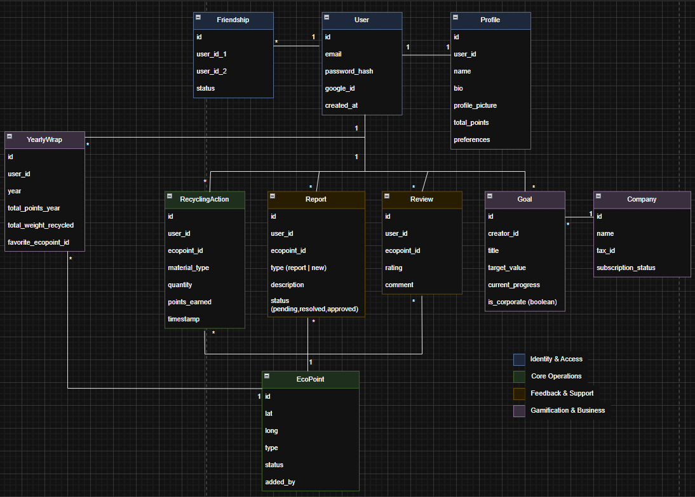
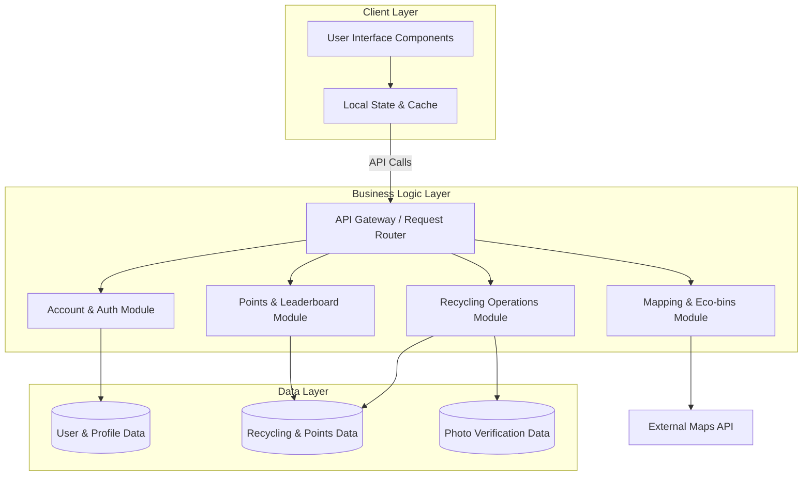
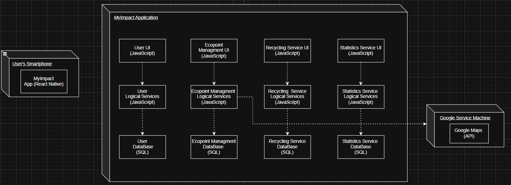
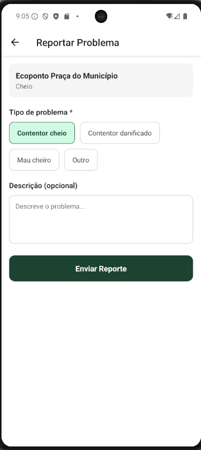
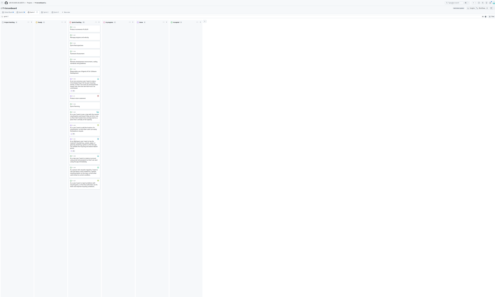

> [!NOTE] In this file, you will find the structure you should follow to document your mobile app in the README.md file for LEIC-ES-2025-26. It is a single file with guidelines, as comments, only seen in Edit mode, not in Preview mode. You can add more sections, but for assessment reasons and automation, please make sure to include all sections of this template. Your professors will clarify about specificities of your app.

# MyImpact Development Report

Welcome to the documentation of MyImpact!

This Software Development Report, tailored for LEIC-ES-2025-26, provides comprehensive details about MyImpact, starting from an high-level vision and going into low-level implementation decisions. 

It is organised by the following activities: 

* [Business modeling](#Business-Modelling) 
  * [Product Vision](#Product-Vision)
  * [Features and Assumptions](#Features-and-Assumptions)
* [Requirements](#Requirements)
  * [User stories](#User-stories)
  * [Domain model](#Domain-model)
  * [User interfaces](#User-interfaces)
* [Architecture and Design](#Architecture-And-Design)
  * [Logical architecture](#Logical-Architecture)
  * [Physical architecture](#Physical-Architecture)
  * [Functional prototype](#Functional-Prototype)
* [Project management](#Project-Management)
  * [Sprint 0](#Sprint-0)
  * [Sprint 1](#Sprint-1)
  * [Sprint 2](#Sprint-2)
  * [Sprint 3](#Sprint-3)
  * [Final Release](#Final-Release)

Contributions are expected to be made exclusively by the initial team, but we may open them to the community, after the course, in all areas and topics: requirements, technologies, development, experimentation, testing, etc.

Please contact us!

Thank you!

* Ariana Lopes da Costa up202404631@edu.fe.up.pt
* Madalena Cordeiro Rodrigues up202404211@edu.fe.up.pt
* Miguel Ângelo Quintais Frias up202406974@edu.fe.up.pt
* Ricardo Manuel da Cunha Estevéns up202405321@edu.fe.up.pt
* Tiago Rafael Usandivares Meireles up202403644@edu.fe.up.pt

---
## Business Modelling

MyImpact will be an app where the users will be able to track their recycling and the same time at the same time contribute to a more sustainable community through gamified challenges. 

### Product Vision

For eco-conscious citizens and communities
Who need an incentive to maintain daily recycling habits,
MyImpact is a gamified mobile application
That transforms everyday waste separation into a rewarding, social, and competitive experience.
Unlike traditional recycling systems that rely solely on civic goodwill,
Our product actively motivates users through a point-based reward system, weekly leaderboards, and real-world benefits, driving a measurable and lasting positive impact on the environment.

### Features and Assumptions
### Features

- **Account Management & Customization:** Users can register (via email or Google), manage their profiles, and spend earned coins on cosmetic upgrades like profile borders.
- **Photo-Verified Recycling:** A core system where users log their recycling by snapping a photo of the items at the bin to earn reward points.
- **Interactive Eco-Bin Map:** A community-driven map to locate nearby recycling bins, check their current capacity, report issues, and add unlisted bins.
- **Social Leaderboards:** A competitive space where users can invite friends via a link and compare their recycling progress in weekly or monthly rankings.
- **Personal & Corporate Goals:** Users can set their own recycling milestones or participate in sponsored challenges created by partner companies to earn bonus rewards.
- **Yearly Recycling Insights:** A personal analytics dashboard tracking monthly habits, culminating in a highly shareable, "Wrapped"-style annual summary.
- **Government Initiatives Hub:** An informational feed keeping users updated on local government recycling payback programs and future partnerships.

### Assumptions and Dependencies

**Assumptions:**
- Users own smartphones with a functional camera and active GPS/location services.
- Users are willing to interact with the app at the exact moment of disposal to ensure the accuracy of the location and the photo.
- The community will be motivated enough by the gamification elements to actively report bin issues and keep the map accurate.
- Local businesses and governments will be open to partnering with the platform to sponsor goals or provide tangible rewards.

**Dependencies:**
- **Mapping Systems:** The interactive map feature depends on a third-party mapping API (such as Google Maps or Mapbox) to display locations and handle user navigation.
- **Image Verification:** Validating the submitted recycling photos to prevent cheating will likely depend on an external AI image recognition API or a cloud processing service.
- **External Authentication:** The quick registration process depends on third-party authentication providers (e.g., Google Sign-In API).
## Requirements

### User Stories

To address our product vision, the requirements for MyImpact were structured into user stories following the INVEST guidelines. Rather than listing every individual story here, they are grouped into four main core epics (fully detailed with Gherkin acceptance tests in our GitHub Project Board):

* **User Management & Customization:** Authentication, profile management, password recovery, and cosmetic progression.
* **Tracking & Gamification:** The core loop of logging recycling via photo verification, viewing history, leaderboards, and setting goals.
* **Interactive Mapping & Community:** Locating nearby Eco-bins, checking capacity, adding bins, leaving reviews, and reporting maintenance issues.
* **Social & Corporate Integration:** Inviting friends and participating in B2B corporate-sponsored recycling challenges.

### Domain model

To provide a clear understanding of the MyImpact ecosystem, our domain model is structured into four main logical areas:

* **Identity & Access (Blue):** `User`, `Profile`, and `Friendship` manage authentication, social connections, and cosmetic preferences.
* **Core Operations (Green):** `EcoPoint` (physical recycling bins) and `RecyclingAction` (the transactional log connecting a user to a bin, recording material and points).
* **Feedback & Support (Yellow):** `Report` (community tickets regarding bin issues) and `Review` (user ratings).
* **Gamification & Business (Purple):** `Goal`, `Company`, and `YearlyWrap` managing targets, corporate subscriptions, and annual metrics.

## Architecture and Design

### Logical architecture
The logical architecture separates the presentation layer (mobile app) from the core business logic and external APIs, ensuring modularity and easier testing.

### Physical architecture

The physical architecture outlines the deployment of the MyImpact system nodes and communication protocols.

### Functional prototype

For our Sprint 0 increment, we implemented a vertical slice of the MyImpact application using **React Native** and the **Expo Router**. 

Currently, the prototype includes:
* **Core Interface:** Navigation structure and primary screens (e.g., Report Problem workflow).
* **Automated Quality Assurance:** We integrated **Detox** for End-to-End (E2E) automated acceptance testing. The prototype includes automated flows that launch the app, navigate the map interface, select a bin, and successfully submit a problem report, ensuring critical user journeys function properly. We also experimented with **Maestro** (`log_recycling_test.yaml`) for secondary UI validations.

## Project management

### Sprint 0

During Sprint 0, the team established the project foundation and a shared vision. We successfully:
* Defined the **Product Vision** and core requirements using INVEST-compliant User Stories.
* Designed the **Domain Model** and the **Logical/Physical Architectures** to guide development.
* Set up the development environment and CI/CD pipelines (GitHub Actions).
* Developed a **Functional Prototype** (v1.0.0) focusing on the "Report Problem" user journey, validated by automated E2E tests .
* Simulated our first defect tracking cycle to ensure rigorous QA standards.

#### Retrospective

**Did well:**

- We had a great distribution of tasks across the team, allowing us to parallelize the work (e.g., UI mockups, architecture design, and CI/CD setup were done simultaneously).

- Successfully integrated automated E2E testing (Detox/Maestro) right from the start, which gives us a solid safety net for future development.

- Diagrammed our logical architecture as code (Mermaid.js) directly in GitHub, keeping our documentation clean and version-controlled.

**Do differently:**

- We should verify repository permissions on day one. We tried to set up branch protection rules for the main branch but realized too late that we lacked Admin rights in the organization repo.

- We left the README cleanup and template formatting to the very end of the sprint. Next time, we should update the documentation iteratively as tasks are completed.

**Puzzles:**

 - We are still unsure if our chosen external Map API will integrate smoothly with the React Native prototype without performance hiccups on older mobile devices.

- Are the Maestro automated tests robust enough to handle the complex UI flows of the gamification features, or will they become flaky?

**List of a few improvements to implement next Sprint:**

- Enforce a strict "Accepted" column workflow: tasks shouldn't just stop at "Done"; they need a formal QA check by another team member before moving to "Accepted".

- Coordinate with the teaching staff early on regarding repository permissions or external integrations to avoid blocked tasks.

- Kick off Sprint 1 by picking the highest priority "Must-have" user stories from the "Ready" column during our Sprint Planning.

### Sprint 1

### Sprint 2

### Sprint 3

### Sprint 4

### Final Release
