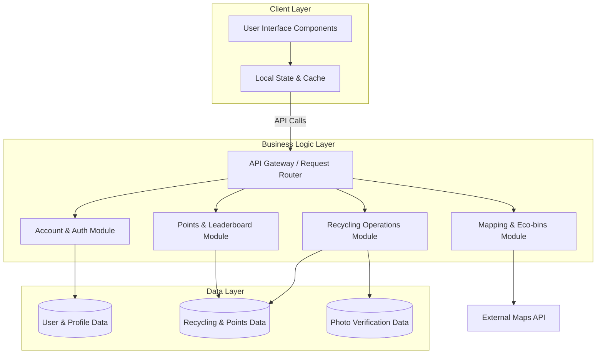
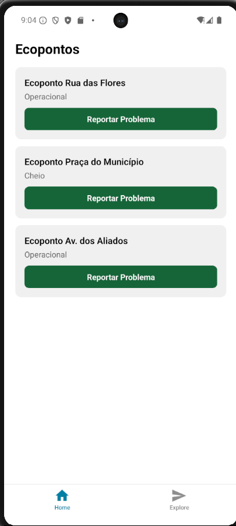
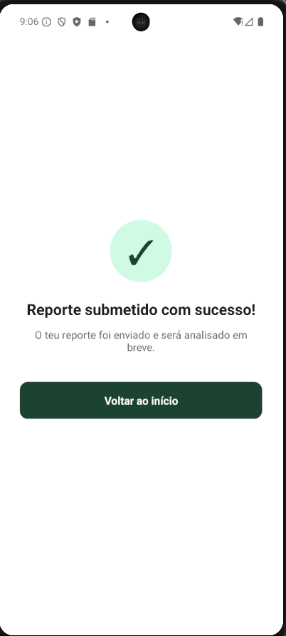
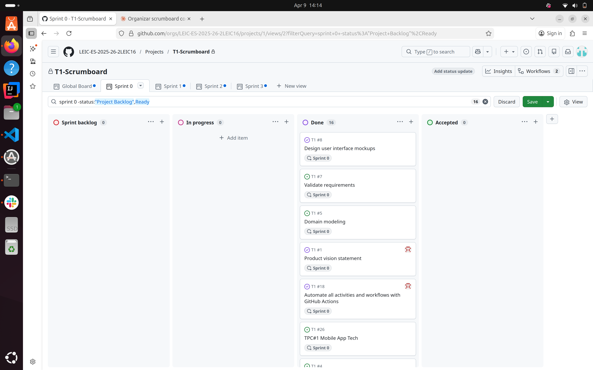
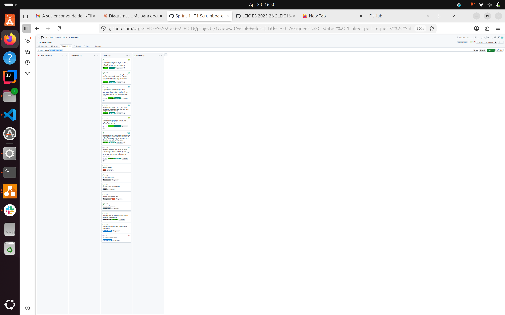

> [!NOTE] In this file, you will find the structure you should follow to document your mobile app in the README.md file for LEIC-ES-2025-26. It is a single file with guidelines, as comments, only seen in Edit mode, not in Preview mode. You can add more sections, but for assessment reasons and automation, please make sure to include all sections of this template. Your professors will clarify about specificities of your app.

# MyImpact Development Report

Welcome to the documentation of MyImpact!

This Software Development Report, tailored for LEIC-ES-2025-26, provides comprehensive details about MyImpact, starting from an high-level vision and going into low-level implementation decisions. 

It is organised by the following activities: 

* [Business modeling](#Business-Modelling) 
  * [Product Vision](#Product-Vision)
  * [Features and Assumptions](#Features-and-Assumptions)
* [Requirements](#Requirements)
  * [User stories](#User-stories)
  * [Domain model](#Domain-model)
  * [User interfaces](#User-interfaces)
* [Architecture and Design](#Architecture-And-Design)
  * [Logical architecture](#Logical-Architecture)
  * [Physical architecture](#Physical-Architecture)
  * [Functional prototype](#Functional-Prototype)
* [Project management](#Project-Management)
  * [Sprint 0](#Sprint-0)
  * [Sprint 1](#Sprint-1)
  * [Sprint 2](#Sprint-2)
  * [Sprint 3](#Sprint-3)
  * [Final Release](#Final-Release)

Contributions are expected to be made exclusively by the initial team, but we may open them to the community, after the course, in all areas and topics: requirements, technologies, development, experimentation, testing, etc.

Please contact us!

Thank you!

* Ariana Lopes da Costa up202404631@edu.fe.up.pt
* Madalena Cordeiro Rodrigues up202404211@edu.fe.up.pt
* Miguel Ângelo Quintais Frias up202406974@edu.fe.up.pt
* Ricardo Manuel da Cunha Estevéns up202405321@edu.fe.up.pt
* Tiago Rafael Usandivares Meireles up202403644@edu.fe.up.pt

---
## Business Modelling

MyImpact will be an app where the users will be able to track their recycling and the same time at the same time contribute to a more sustainable community through gamified challenges. 

### Product Vision

For eco-conscious citizens and communities
Who need an incentive to maintain daily recycling habits,
MyImpact is a gamified mobile application
That transforms everyday waste separation into a rewarding, social, and competitive experience.
Unlike traditional recycling systems that rely solely on civic goodwill,
Our product actively motivates users through a point-based reward system, weekly leaderboards, and real-world benefits, driving a measurable and lasting positive impact on the environment.

### Features and Assumptions
### Features

- **Account Management & Customization:** Users can register (via email or Google), manage their profiles, and spend earned coins on cosmetic upgrades like profile borders.
- **Photo-Verified Recycling:** A core system where users log their recycling by snapping a photo of the items at the bin to earn reward points.
- **Interactive Eco-Bin Map:** A community-driven map to locate nearby recycling bins, check their current capacity, report issues, and add unlisted bins.
- **Social Leaderboards:** A competitive space where users can invite friends via a link and compare their recycling progress in weekly or monthly rankings.
- **Personal & Corporate Goals:** Users can set their own recycling milestones or participate in sponsored challenges created by partner companies to earn bonus rewards.
- **Yearly Recycling Insights:** A personal analytics dashboard tracking monthly habits, culminating in a highly shareable, "Wrapped"-style annual summary.
- **Government Initiatives Hub:** An informational feed keeping users updated on local government recycling payback programs and future partnerships.

### Assumptions and Dependencies

**Assumptions:**
- Users own smartphones with a functional camera and active GPS/location services.
- Users are willing to interact with the app at the exact moment of disposal to ensure the accuracy of the location and the photo.
- The community will be motivated enough by the gamification elements to actively report bin issues and keep the map accurate.
- Local businesses and governments will be open to partnering with the platform to sponsor goals or provide tangible rewards.

**Dependencies:**
- **Mapping Systems:** The interactive map feature depends on a third-party mapping API (such as Google Maps or Mapbox) to display locations and handle user navigation.
- **Image Verification:** Validating the submitted recycling photos to prevent cheating will likely depend on an external AI image recognition API or a cloud processing service.
- **External Authentication:** The quick registration process depends on third-party authentication providers (e.g., Google Sign-In API).
## Requirements

### User Stories

To address our product vision, the requirements for MyImpact were structured into user stories following the INVEST guidelines. Rather than listing every individual story here, they are grouped into four main core epics (fully detailed with Gherkin acceptance tests in our GitHub Project Board):

* **User Management & Customization:** Authentication, profile management, password recovery, and cosmetic progression.
* **Tracking & Gamification:** The core loop of logging recycling via photo verification, viewing history, leaderboards, and setting goals.
* **Interactive Mapping & Community:** Locating nearby Eco-bins, checking capacity, adding bins, leaving reviews, and reporting maintenance issues.
* **Social & Corporate Integration:** Inviting friends and participating in B2B corporate-sponsored recycling challenges.

### Domain model

To provide a clear understanding of the MyImpact ecosystem, our domain model is structured into four main logical areas:

* **Identity & Access (Blue):** `User`, `Profile`, and `Friendship` manage authentication, social connections, and cosmetic preferences.
* **Core Operations (Green):** `EcoPoint` (physical recycling bins) and `RecyclingAction` (the transactional log connecting a user to a bin, recording material and points).
* **Feedback & Support (Yellow):** `Report` (community tickets regarding bin issues) and `Review` (user ratings).
* **Gamification & Business (Purple):** `Goal`, `Company`, and `YearlyWrap` managing targets, corporate subscriptions, and annual metrics.

## Architecture and Design

### Logical architecture
The logical architecture separates the presentation layer (mobile app) from the core business logic and external APIs, ensuring modularity and easier testing.

### Physical architecture

The physical architecture outlines the deployment of the MyImpact system nodes and communication protocols.

### Functional prototype

For our Sprint 0 increment, we implemented a vertical slice of the MyImpact application using **React Native** and the **Expo Router**. 

Currently, the prototype includes:
* **Core Interface:** Navigation structure and primary screens (e.g., Report Problem workflow).
* **Automated Quality Assurance:** We integrated **Detox** for End-to-End (E2E) automated acceptance testing. The prototype includes automated flows that launch the app, navigate the map interface, select a bin, and successfully submit a problem report, ensuring critical user journeys function properly. We also experimented with **Maestro** (`log_recycling_test.yaml`) for secondary UI validations.

## Project management

### Sprint 0

During Sprint 0, the team established the project foundation and a shared vision. We successfully:
* Defined the **Product Vision** and core requirements using INVEST-compliant User Stories.
* Designed the **Domain Model** and the **Logical/Physical Architectures** to guide development.
* Set up the development environment and CI/CD pipelines (GitHub Actions).
* Developed a **Functional Prototype** (v1.0.0) focusing on the "Report Problem" user journey, validated by automated E2E tests .
* Simulated our first defect tracking cycle to ensure rigorous QA standards.

#### Retrospective

**Did well:**

- We had a great distribution of tasks across the team, allowing us to parallelize the work (e.g., UI mockups, architecture design, and CI/CD setup were done simultaneously).

- Successfully integrated automated E2E testing (Detox/Maestro) right from the start, which gives us a solid safety net for future development.

- Diagrammed our logical architecture as code (Mermaid.js) directly in GitHub, keeping our documentation clean and version-controlled.

**Do differently:**

- We should verify repository permissions on day one. We tried to set up branch protection rules for the main branch but realized too late that we lacked Admin rights in the organization repo.

- We left the README cleanup and template formatting to the very end of the sprint. Next time, we should update the documentation iteratively as tasks are completed.

**Puzzles:**

 - We are still unsure if our chosen external Map API will integrate smoothly with the React Native prototype without performance hiccups on older mobile devices.

- Are the Maestro automated tests robust enough to handle the complex UI flows of the gamification features, or will they become flaky?

**List of a few improvements to implement next Sprint:**

- Enforce a strict "Accepted" column workflow: tasks shouldn't just stop at "Done"; they need a formal QA check by another team member before moving to "Accepted".

- Coordinate with the teaching staff early on regarding repository permissions or external integrations to avoid blocked tasks.

- Kick off Sprint 1 by picking the highest priority "Must-have" user stories from the "Ready" column during our Sprint Planning.

### Sprint 1

### Retrospective

**Did well (Start / Continue):**
* **Value Delivery:** We successfully completed 6 core features (Authentication, Reporting, Map, Camera Validation). The prototype is fully functional.
* **Database Integration:** Firestore is connected and successfully writing real data.
* **Quality Infrastructure:** We managed to configure CI in GitHub Actions and implemented unit tests with Jest in the codebase.

**Do differently (Pain Points):**
* **Folder and Dependency Management:** We ran `npm` and `expo` commands in the repository root folder (`T1`) instead of the project folder (`eco-app`). This caused duplicated `node_modules` and `.expo` folders, breaking TypeScript and VS Code.
* **Expo Router Navigation:** There was confusion with files sharing the same name (the main `index.tsx` vs the tabs `index.tsx`), leading to Git conflicts and temporarily lost code.
* **E2E Testing Environment:** Leaving the Maestro configuration for the final hours of the Sprint generated extra stress due to environment variables and system path issues on Windows.

**Actionable Improvements for Sprint 2:**
* Enforce a strict rule: all terminals must always be in `cd eco-app` before installing any package.
* Configure the project as a VS Code Workspace for all team members, preventing the editor from getting lost in root folders.
* Ensure testing tools (Maestro, Jest) are properly configured and running on everyone's local machines on day one of the Sprint.

### Sprint 2

### Sprint Review🚀

**1. Sprint Planning Summary**

In the Sprint 3 planning session, the team decided to increase the scope of planned features, as we felt the app was too basic and not advanced enough to meet our vision. The new features planned for this sprint were:

*Profile Editing
*Weekly Friends Leaderboard
*User Profile & Recycling Activity
*Recycling Objectives & Goals
*MyImpact Wrapped / Recycling Summary
*Password Recovery
*Personalized Home Screen

**2. Product Increment Status (Definition of Done)**

We successfully delivered:

✅ Profile Editing: Users can now edit their profile information, including personal details, allowing them to customize and keep their account up to date.

✅ Weekly Friends Leaderboard: Added a weekly leaderboard where users can compare recycling points with friends, encouraging motivation and friendly competition.

✅ User Profile & Recycling Activity: Users can access a dedicated profile screen to view personal information and track their recycling activity within the app.

✅ Recycling Objectives & Goals: Users can create personalized recycling objectives to stay motivated and monitor their environmental progress over time.

✅ MyImpact Wrapped / Recycling Summary: Added a recycling activity summary feature that highlights users' eco-friendly habits and achievements, making it easy to review and share progress with friends.

✅ Password Recovery: Users can now recover their password securely in case they forget their account credentials, ensuring continuous access to the app.

✅ Personalized Home Screen: Introduced a redesigned home screen that greets users and displays monthly recycling impact, favourite ecopoints, and a highlighted monthly goal, allowing quick access to personal sustainability insights and recycling locations.

**3. Flow Management and Velocity**

### Work in Progress (WiP):
Strong control over workflow was maintained, ensuring no more than 3 Pull Requests (PRs) were open simultaneously, in line with the policy of avoiding paused or scattered work.

### Velocity vs. Delivery:
With an ambitious plan of 30 story points, the team rose to the challenge despite the increased scope. The sprint required a strong collective effort to deliver all planned features, but the team managed to complete everything within the sprint window. A few tasks required extra attention and iteration, but no feature was left behind — all 30 points were successfully delivered, reflecting a solid and committed performance from the whole team.

**4. Sprint Retrospective (Critical Reflection)**

### Problem Identification:
The team recognized that we needed to implement significantly more features this sprint to bring the app up to the desired level of quality and completeness. As a result, this sprint was noticeably more stressful and eventful than the previous one — but nothing we couldn't manage as a team.

### Analysis:
WiP was well controlled, as was the availability of team members during this sprint.

### Improvement Point:
Hold more in-person team meetings outside class, as that is when the team is most productive.

**5. Metrics Status (Dashboard)**

Estimates: Completed — 30 total story points defined during Planning.

WiP Control: ✅ Excellent — Maximum of 3 active PRs for 5 team members.

Stakeholder Review: ✅ Completed — Demonstration of profile editing, leaderboard, and personalized home screen.

Product Increment: ✅ Completed — All features planned for this sprint were successfully implemented and delivered.

**6. 🐞 Bug Report & Technical Impediments**

1. Profile Statistics Not Updating After New Recycling Entry {(State Sync Issue)}
After a user logged a new recycling activity, the profile statistics screen was not reflecting the updated values in real time, continuing to display outdated data until a full app restart.

### Impact:
Users had no immediate visual confirmation that their recycling action had been registered, leading to confusion and a lack of trust in the app's data accuracy.

### Proposed Solution:
The fix involved implementing a reactive state listener on the profile statistics component, ensuring it subscribes to recycling data updates and triggers a UI re-render automatically upon any new entry being saved. This guarantees that all metrics shown on the profile are always up to date without requiring a manual refresh or restart.

2. Flaky and Inconsistent Maestro UI Tests {(Test Reliability Issue)}

During the testing phase, several Maestro end-to-end tests were producing inconsistent results — passing on some runs and failing on others without any changes to the underlying code, making it difficult to trust the test suite and validate feature behaviour reliably.

### Impact:
The unpredictability of the test results slowed down the validation process and created uncertainty around whether failures were genuine bugs or test instability, undermining confidence in the CI pipeline.

### Proposed Solution:
The team adopted Maestro Studio to debug and fine-tune the flaky tests. Using Maestro Studio's interactive interface, we were able to identify timing issues and fragile selectors that were causing the inconsistencies. After adjusting the test flows accordingly, the suite became stable and reliable across consecutive runs.

**Beggining of the Sprint**

**Ending of the Sprint**

### Sprint 3

### Sprint 4

### Final Release
